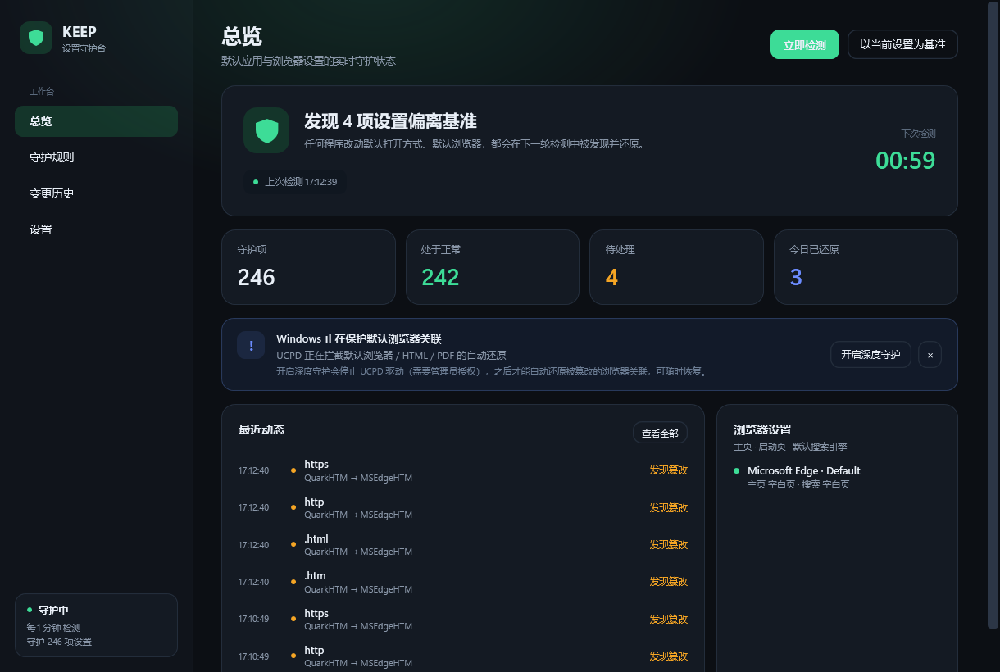
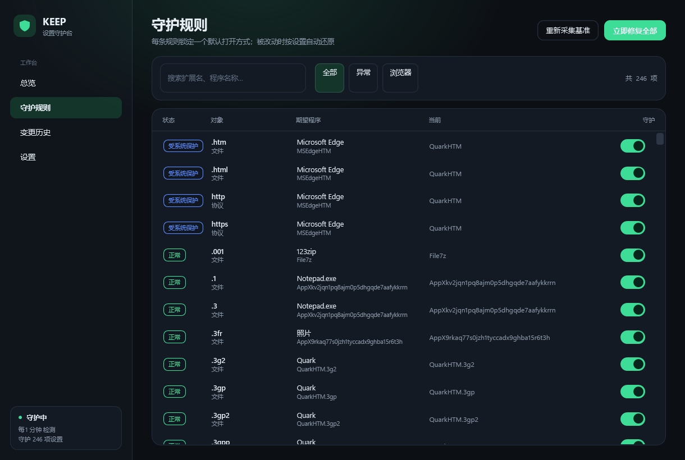
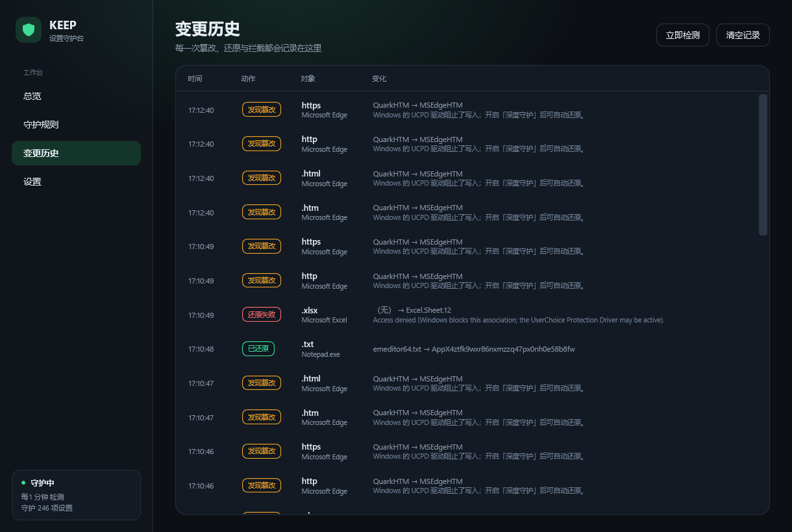
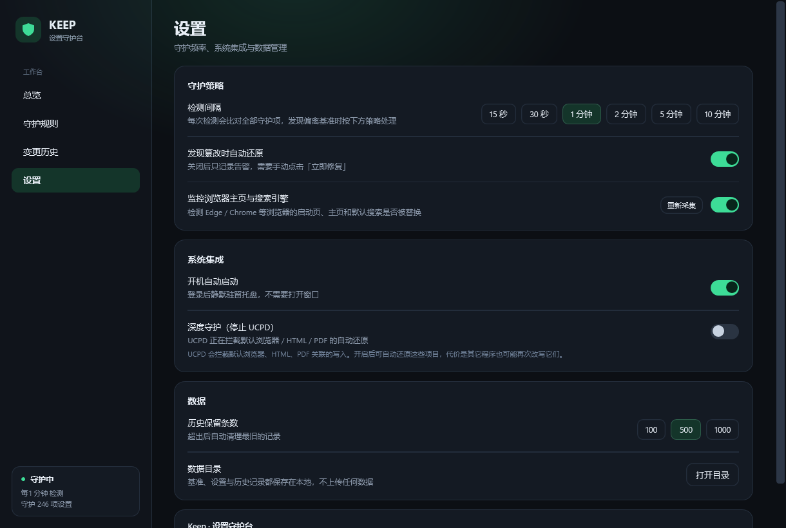

# Keep · 设置守护台

一个常驻托盘的 Windows 小工具：把你现在的「默认打开方式」和「浏览器主页 / 搜索引擎」记成基准，每隔一段时间比对一次，**发现被流氓软件改掉就自动改回去**，并把每次篡改与还原记进历史。



## 它解决什么问题

安装器、破解补丁、捆绑软件经常做这些事：

- 把 `.pdf`、`.txt`、`.zip`、`.mp4` 等文件类型的默认程序换成自己的；
- 把 `http/https`、`.html` 的默认浏览器换成某个「安全浏览器」；
- 把浏览器主页、启动页、默认搜索引擎改成导航站。

Keep 的做法是把用户认可的配置固化成「基准」，之后每一轮检测都和基准比对，偏离就写回，并在写入后用 Windows 自己的接口确认真的生效了。

## 工作台

| 总览 | 守护规则 |
| --- | --- |
|  |  |

| 变更历史 | 设置 |
| --- | --- |
|  |  |

## 能力

- **默认应用守护**：抓取当前用户全部 `UserChoice` 关联（本机 246 项：246 个扩展名 / 协议），逐项比对、自动还原、验证生效。
- **默认浏览器守护**：把 `http/https/.html/.htm` 作为一组浏览器规则，单独在概览里展示状态。
- **浏览器设置守护**：读取 Edge / Chrome / Brave / Vivaldi 的 `Preferences`，监控主页、启动页与默认搜索引擎是否被替换；浏览器关闭时可一键写回。
- **常驻托盘**：关闭窗口不退出，检测与还原继续；可选开机自启。
- **历史可审计**：每次「发现篡改 / 已还原 / 被拦截 / 还原失败」都带时间、对象、前后值和原因。
- **静默修复**：默认自动还原且不弹窗，只在托盘和总览里留痕。

## 关键实现

### 1. 两代 UserChoice 哈希

Windows 用注册表里的哈希来确认「这个默认程序是用户自己选的」：

- 旧版键：`HKCU\...\FileExts\<ext>\UserChoice`（`ProgId` + `Hash`）
- 新版键（Windows 11 24H2+ 真正生效的那个）：`UserChoiceLatest\Hash`，选择记录在 `UserChoiceLatest\ProgId`

只写旧版键在新系统上会被 Explorer **静默忽略**。本项目两套哈希都实现了：

- `UserChoiceHash`：经典 V1 算法（MD5 + 常数混淆，哈希取决于键的写入时间）。
- `UserChoiceLatestHash`：24H2+ 的二代算法（基于作者公开逆向的 `7D60` 流水线，含查表编码与 MixA/MixB），并处理了「时间戳只保留到毫秒」「按 MachineID 末位分三种拼接顺序」等细节。

写入顺序也很关键：**先写 Latest，再写旧版，最后只通知一次 Shell**。如果中途通知，Windows 会看到两套数据不一致，直接把 `UserChoice` 删掉（这是实机踩出来的坑）。

### 2. UCPD：Windows 自己的「默认程序保护」

Windows 11 24H2 起引入 `UCPD.sys`（User Choice Protection Driver），会拒绝第三方进程写入 `http/https/.html/.htm/.pdf`（以及部分 Office 关联）的 UserChoice。实测：

```
> reg add HKCU\...\FileExts\.html\UserChoice ...
ERROR: Access is denied.
```

而且它连 `UserChoiceLatest` 一起拦。所以：

- **标准模式**：能检测所有篡改，能自动修复不受 UCPD 保护的项目；
- **深度守护**：需要一次管理员授权，停止 UCPD 驱动（`sc config UCPD start= disabled` + `sc stop UCPD`），之后默认浏览器也能自动还原；随时可以恢复驱动。

界面上把这条限制显式展示出来，不假装什么都能修。

### 3. 写入必须验证

每次修复后都调用 `IApplicationAssociationRegistration::QueryCurrentDefault` 查询「系统实际的默认程序」，只有返回目标 ProgId 才算成功，否则记为失败/被拦截。这样不会出现「注册表写了但根本没生效」的假成功。

## 目录

```
src/Keep.Core/            引擎与 Windows 交互（无 UI 依赖）
  Associations/           UserChoice 读写、两代哈希、UCPD 检测
  Engine/                 基准采集、扫描、修复、UCPD 开关
  Browser/                Chromium Preferences 监控
  Model/                  规则、设置、事件历史
  Storage/                JSON 持久化
src/Keep.App/             WPF 工作台（托盘、定时器、四个页面）
src/Keep.Cli/             命令行诊断工具（verify / scan / assocwrite / dump）
tests/Keep.Tests/         哈希与存储的回归测试（内置向量）
tools/                    逆向参考资料与生成脚本（开发用）
```

## 构建与运行

需要 .NET 10 SDK（Windows）。

```powershell
dotnet build Keep.sln
dotnet run --project src/Keep.App      # 工作台
dotnet run --project tests/Keep.Tests  # 回归测试
```

命令行诊断：

```powershell
dotnet run --project src/Keep.Cli -- capture          # 采集基准
dotnet run --project src/Keep.Cli -- scan             # 只检测
dotnet run --project src/Keep.Cli -- scan --repair    # 检测并还原
dotnet run --project src/Keep.Cli -- dump .html .zip  # 查看某个关联的两套哈希
```

## 使用

1. 首次启动会自动把当前配置记为基准（也可以随时点「以当前设置为基准」重新采集）。
2. 如果你现在的默认浏览器已经被篡改：先在 Windows 设置里选回正确的浏览器，再重新采集基准。
3. 需要守护默认浏览器 / HTML / PDF 时，在总览的蓝色提示条或设置里开启「深度守护」，按提示授权。
4. 关闭窗口只是收进托盘，守护不会停。

## 验证记录（本机 Windows 11 25H2 / 26200）

- 旧版哈希：对现有 **245 条** UserChoice 全部重算成功（245/245），说明算法与 Explorer 完全一致。
- 二代哈希：同时复现了官方参考实现的公开向量（`JOBZ2dl4dKM=`）与本机 `UserChoiceLatest` 的全部记录。
- 实机演练：把 `.txt` 改成 EmEditor → 检测为「已被篡改」→ 自动还原为记事本 → 系统接口确认为记事本。
- 误伤修复：`.zip` 被实验改坏后，用新写入逻辑恢复为 `HrASOpen` 并确认生效。
- UCPD 拦截：`http/https/.html/.htm` 的写入被系统拒绝，界面标记为「受系统保护」，不反复重试。

## 已知限制

- 只写 `HKCU`（当前用户），不改系统级 `HKLM` 关联，因此不需要常驻管理员权限。
- 浏览器 `Preferences` 中部分字段有 Chrome 自己的 MAC 校验，Keep 写回后如果被浏览器再次改回，会在下一轮检测里再次出现；这种情况下会持续记录而不是假装成功。
- 本程序会写 `UserChoice`，行为特征与「默认程序劫持」一致，部分安全软件（如火绒、360）可能误报/隔离。开发时把项目目录加入信任区即可；分发给最终用户时需要签名与加白说明。
- 深度守护关闭的是 Windows 自带保护，开启前请确认你理解代价：其它程序也可能再次改写这些关联，需要依赖 Keep 的定时检测兜底。

## 隐私

所有数据都在本机 `%LOCALAPPDATA%\Keep`：`baseline.json`（基准）、`settings.json`、`events.jsonl`（历史）、`browsers.json`。不联网、不上传。
